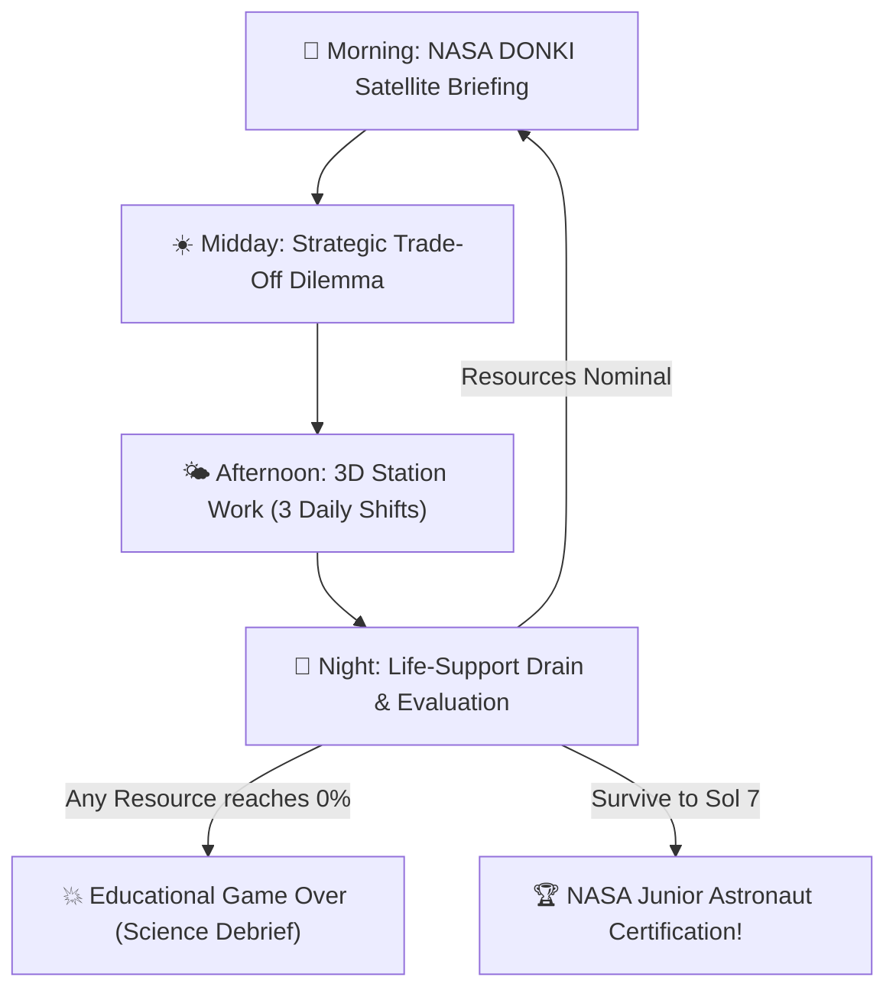
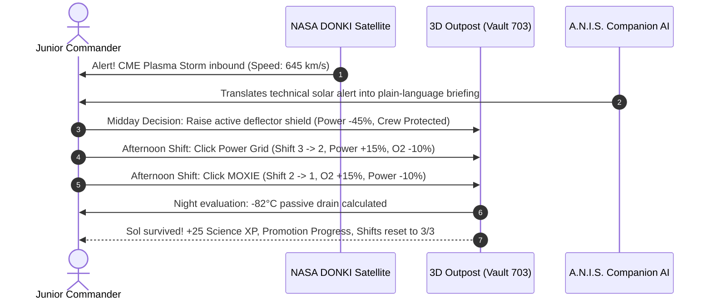
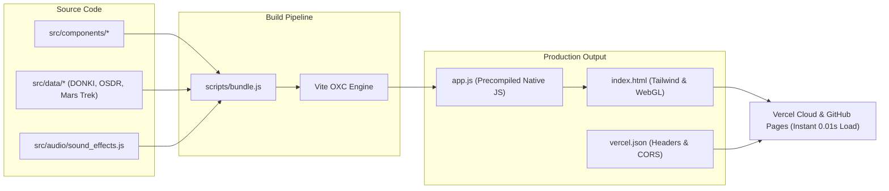

# 🚀 Astro-Gotchi: Mars Outpost Survival
### *NASA Space Apps Challenge — [Build a Junior Astronaut Mission Trainer]*

---

## 🌌 1. Executive Summary

**Astro-Gotchi: Mars Outpost Survival** is an interactive, browser-based space mission trainer designed for young aspiring astronauts aged **7 to 12 years old**. Built as a fusion of retro-futuristic **Fallout Shelter / Vault-Tec** aesthetics and authentic **NASA Space Science Data**, Astro-Gotchi transforms space education into an engaging survival dilemma.

Unlike traditional virtual pet games where characters simply demand food or sleep, Astro-Gotchi introduces children to **The Golden Rule of Spaceflight: Every Decision is a Trade-Off**. In the harsh environment of deep space, there is never a 100% risk-free choice. Young commanders must balance power, breathable oxygen, and astronaut physical endurance against authentic cosmic hazards to keep **Commander Leo** alive through **7 Martian Sols (Days)** to earn their official **NASA Junior Astronaut Mission Certification**.



---

## ⚖️ 2. Core Game Mechanics: The 3 Vital Lifelines

Survival hinges on maintaining 3 interconnected life-support pillars. If any bar reaches **0%**, life-support collapses and the simulation ends with a real scientific explanation of what happened:

| Vital Resource | Icon | Spaceflight Function | In-Game Danger Threshold |
| :--- | :---: | :--- | :--- |
| **Power Grid** | ⚡ | Powers outpost electric heaters (-82°C nights) and electromagnetic radiation deflector shields. | **0% = Deep Freeze**: Pangkalan membeku, heater padam, sistem elektronik offline. |
| **Oxygen (ISRU)** | 💨 | Maintained by the **MOXIE** reactor (splitting Martian CO2 into O2) and Bio-Dome greenhouse. | **0% = Hypoxia Crisis**: Kehabisan oksigen bertekanan, baju antariksa EVA tidak berfungsi. |
| **Crew Health** | ❤️ | Represents astronaut physical integrity against radiation doses (**mSv**) and low-G muscle atrophy. | **0% = Critical Fatigue**: Terkena sindrom radiasi kosmik akut atau atrofi muskuloskeletal parah. |

---

## 🔄 3. The 4-Phase Sol Cycle (Martian Day Loop)

Every Martian Sol (24 hours, 39 minutes, 35 seconds) follows a realistic mission schedule:



1. **Morning Briefing (Space Weather Satellite Alert)**:
   - Receives authentic solar telemetry from NASA's **DONKI** space weather database (Coronal Mass Ejections, Solar Flares, High-Speed Solar Winds).
   - Accompanied by **A.N.I.S. (Autonomous NASA Intelligence Sidekick)**, who translates complex physics into relatable analogies for kids.
2. **Midday Dilemma (Critical Trade-Off Choice)**:
   - Player faces high-stakes scenarios: e.g., activate full shields against a solar flare (*high battery drain*) vs. retreat crew into a regolith bunker (*congested air, saves power*).
3. **Afternoon Maintenance (3 Daily Action Shifts)**:
   - Player allocates **3 Work Shifts per Sol**. 
   - Deploying Leo to stasiun kerja in the interactive 3D diorama activates low-gravity parabolic jumps (**0.38g Mars gravity**) and real-time trade-off calculations.
4. **Night Evaluation & Debrief**:
   - Outpost passive drain is computed as the Martian night plunges to -82°C.
   - If successful, the player earns **Science XP** toward ranks: *Cadet $\rightarrow$ Specialist $\rightarrow$ Flight Engineer $\rightarrow$ Outpost Commander $\rightarrow$ Chief Mars Explorer*.

---

## 🛰️ 4. Authentic NASA Data Integrations

Astro-Gotchi embeds real scientific data directly into gameplay:

> [!IMPORTANT]
> **Curated Authentic Repositories (Verified Historical Datasets)**:
> 1. **NASA DONKI (Space Weather Database Of Notifications, Knowledge, Information)**:
>    - Official NASA Activity IDs (e.g., `2014-05-08T09:20:00-FLR-001`, `2017-01-03T03:12:00-CME-001`).
>    - Real instrument detection sources: SOHO LASCO C3, GOES-15, SDO AIA 171, and verified WSA-ENLIL plasma arrival simulations.
> 2. **NASA OSDR (Open Science Data Repository) & RadLab**:
>    - **OSDR-137**: Musculoskeletal muscle atrophy research (prevented by the ARED / NASA T2 Treadmill).
>    - **OSDR-248**: Space anemia study (redistribution of erythrocytes in microgravity).
>    - **OSDR-311**: Perchlorate-free Martian regolith agriculture (greenhouse Bio-Crops).
>    - Cumulative radiation tracking in **milliSieverts (mSv)**.
> 3. **NASA Mars Trek**:
>    - Accurate topographic landing site coordinates at **Jezero Crater** ($18.38^\circ\text{ N}, 77.58^\circ\text{ E}$, elevation -2.5 km), exploration home of the Perseverance rover.

---

## 🎮 5. Key Interactive Features

````carousel
```markdown
### 🪐 1. Full 3D FBX WebGL Outpost Diorama
- Built using Three.js with authentic modular FBX models.
- Features Orbit Controls (360° click-and-drag rotation, smooth scroll zoom).
- Dynamic lighting changes between bright Martian midday and amber dawn/night.
- Commander Leo performs physics-based low-gravity parabolic float-jumps between stations.
```
<!-- slide -->
```markdown
### ⚡ 2. Interactive Hands-On Practice Guide
- Guided on-screen tutorial mode directly demonstrating daily shift deductions.
- Step 1: Clicking Power Grid visibly drops shifts from 3 to 2 (+15% Power, -10% O2).
- Step 2: Clicking MOXIE drops shifts from 2 to 1 (+15% O2, -10% Power).
- Step 3: Clicking Pip-Boy terminal consults A.N.I.S. and unlocks Graduation.
- Auto-resets shifts to 3/3 and restores full nominal vitals for Sol 1 kickoff!
```
<!-- slide -->
```markdown
### 📟 3. Pip-Boy 3000 / A.N.I.S. Companion AI
- Vault-Tec green CRT-phosphor styling with tactile audio chirps and scanlines.
- Integrated with Google Gemini Flash for live space science Q&A.
- Explains Mars biology, orbital mechanics, and DONKI space alerts in child-friendly prose.
- Includes pre-built quick prompt buttons (e.g., "Why is Mars red?", "How does MOXIE make O2?").
```
<!-- slide -->
```markdown
### 🌐 4. Full Bilingual Localization (English & Indonesian)
- Complete language switcher in Settings (`⚙️`).
- Supports 100% of the UI, educational briefings, tutorial steps, event choices, and NASA data inspector.
- Defaults to English for global competition accessibility.
```
````

---

## 🏗️ 6. Technical Architecture & Deployment



- **Runtime**: Native Browser Vanilla ES6 + React 18 UMD + Three.js r128 (Zero heavyweight npm bundler lock-in).
- **Compilation**: Modern **OXC Rust-based compiler engine** compiles 5,700+ lines of JSX into lightweight, precompiled `app.js` (278 KB).
- **Speed**: Instant **sub-second cold start** (removes the 2.5 MB client-side Babel Standalone overhead).
- **Deployment**: Full production support for **Vercel**, **GitHub Pages**, and local one-click Windows execution (`start_game.bat`).
- **Repository**: [https://github.com/noven24/Astro-Gotchi](https://github.com/noven24/Astro-Gotchi)

---

## 🏆 7. Space Apps Challenge Alignment

| NASA Space Apps Criteria | How Astro-Gotchi Delivers |
| :--- | :--- |
| **Inspire & Educate Youth** | Kid-friendly gamified Gotchi format with ranks, levels, XP rewards, and playful low-G animations. |
| **Authentic NASA Data Usage** | Curated historical DONKI solar flare/CME events, OSDR space biology studies, and Mars Trek cartography. |
| **Realistic Spaceflight Lessons** | Teaches critical thinking through **Trade-Offs**: every action costs power, oxygen, or physical health. |
| **Zero-Barrier Accessibility** | Runs instantly in any modern web browser across PC, tablet, and mobile without complex installations. |

